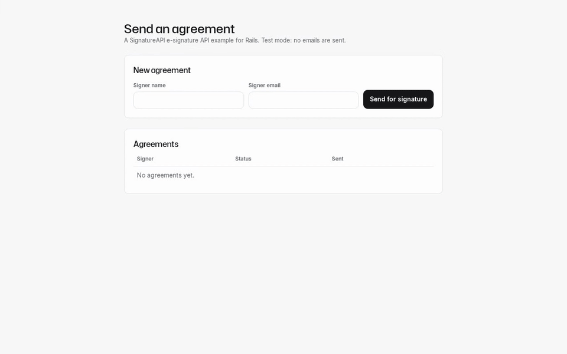
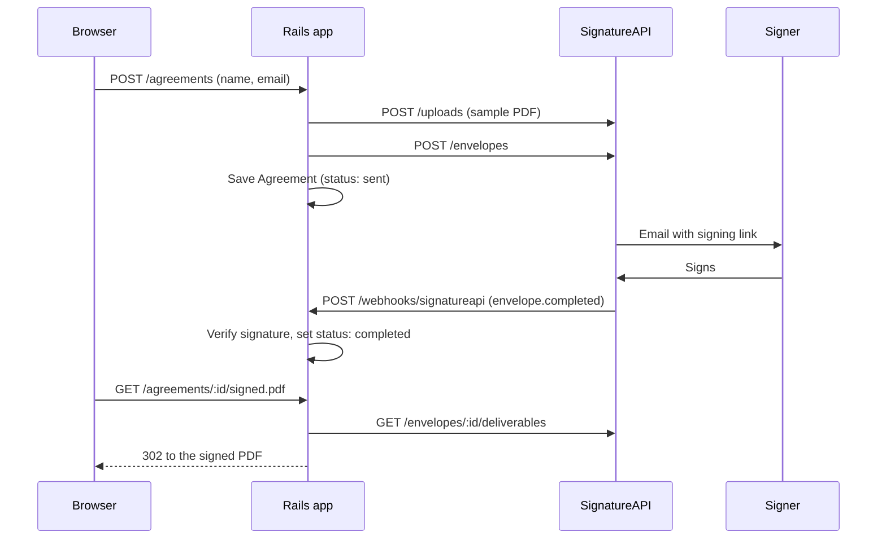

# SignatureAPI Rails starter

A Ruby on Rails template for sending documents for signature with the SignatureAPI e-signature API.

[](docs/media/demo.mp4)

## What it does

- A form takes a signer's name and email.
- The app uploads a sample PDF, creates an envelope and saves an `Agreement`.
- SignatureAPI emails the signer a signing link.
- A webhook updates the agreement's status: completed, rejected, failed or canceled.
- A completed agreement links to its signed PDF.

## Use this template

Select **Use this template** on GitHub to create your own repository, then clone it.

## Quickstart

You need Ruby (see `.ruby-version`) and Node.js 20 or later for `npx`.

Write a test API key to `.env`:

```bash
npx --yes signatureapi init
```

Install gems, create the database and start the app:

```bash
bin/setup --skip-server
bin/rails server -p 3000
```

In another terminal, forward test webhooks to the app:

```bash
npx --yes signatureapi listen --forward-to http://127.0.0.1:3000/webhooks/signatureapi
```

The first `listen` writes `SIGNATUREAPI_WEBHOOK_SECRET` to `.env`. Restart the
server once so it loads the secret.

Open http://localhost:3000 and send an agreement.

## How it works



Two files hold the integration:

- [`app/services/signature_api.rb`](app/services/signature_api.rb) calls the REST API.
  Add places, recipients or envelope options here.
- [`app/controllers/signatureapi_webhooks_controller.rb`](app/controllers/signatureapi_webhooks_controller.rb)
  verifies each webhook with the [Standard Webhooks](https://github.com/standard-webhooks/standard-webhooks)
  library and updates the agreement. Add events here.

## AI agents

The repo comes with the SignatureAPI agent skills and MCP server set up:

- Claude Code: the SignatureAPI plugin (skills and MCP) in `.claude/settings.json`.
- Codex, Cursor, Copilot and others: the same skills in `.agents/skills/`,
  and the MCP server in `.cursor/mcp.json` and `.codex/config.toml`.

Both are pinned to commit `93c02a9f1336952b0da9c71a2da2f0024e8afaaa` of
[signatureapi/skills](https://github.com/signatureapi/skills). To update:

```bash
scripts/update-agent-skills.sh <commit-sha>
```

## Tests

```bash
bin/rails test
bin/rubocop
```

Unit tests stub SignatureAPI with WebMock and sign test webhooks with the
Standard Webhooks library. They need no API key.

The end-to-end test in [`e2e/`](e2e/README.md) sends, signs and completes a
real test-mode envelope. It needs a key and a running `listen`.

## Going to production

- Use a live API key in `SIGNATUREAPI_KEY`.
- Register your public webhook URL in the SignatureAPI dashboard and set
  `SIGNATUREAPI_WEBHOOK_SECRET` to its signing secret.
- Set `SECRET_KEY_BASE` and give SQLite a persistent disk, or switch databases.
- Add authentication for your users. This app has none.
- Deliverable URLs expire after an hour. Download and store the signed PDF
  (for example on `deliverable.generated`) if you need to keep it.

## License

[MIT](LICENSE)
